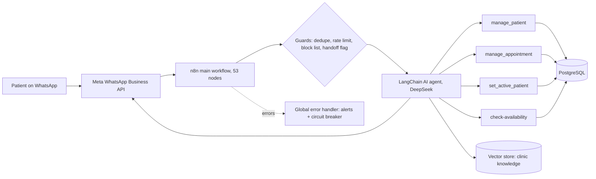

<picture>
  <source media="(prefers-color-scheme: dark)" srcset="https://raw.githubusercontent.com/ubakel/ubakel/main/assets/repo-header-dark.png">
  
</picture>

# Ubakel Front Desk

*A WhatsApp clinic booking assistant.* A multilingual AI receptionist that runs on WhatsApp and turns a normal conversation into a **database-backed appointment**: it finds the patient, checks availability, books and manages the appointment, and hands over to a human when it should.

In end-to-end testing against a demo clinic, a booking completed in about 2 minutes.

<picture>
  <source media="(prefers-color-scheme: dark)" srcset="https://raw.githubusercontent.com/ubakel/ubakel/main/assets/divider-dark.png">
  
</picture>

## What it does

- Books and manages appointments through chat
- **Family profiles:** one phone number can hold several patients, with an active-patient switch
- **Multilingual** replies, with a configurable language tier per clinic
- Answers patient questions from the clinic's own information using **RAG** (vector database and embeddings)
- **Human handoff:** a flag stops the bot and passes the chat to staff
- **Safety rails:** message deduplication, rate limiting, an interaction cap and number blocking
- **Clear boundaries:** it handles bookings and clinic information only, and gives no diagnosis or clinical advice

## Architecture

The main workflow handles the channel and the guard rails. The agent only acts through four narrow tool sub-workflows, each of which reads and writes PostgreSQL, so the bot cannot invent a booking that is not in the database.

## Design choices

- **Official WhatsApp Business API.** The channel runs on Meta's official API, after starting on an unofficial gateway.
- **Tools, not free text, change data.** Every booking change goes through a tool that validates it against the database.
- **Per-clinic configuration.** Clinic name, language behaviour and reply rules live in one config node, so a new clinic is a configuration change, not a rebuild.
- **Fail loudly.** A global error handler alerts the operator, and an in-memory circuit breaker stops repeated failures from flooding alerts.

## Stack

| Layer | Tools |
|---|---|
| Channel | Meta WhatsApp Business API |
| Orchestration | n8n (53-node main workflow plus four tool sub-workflows) |
| AI agent | LangChain agent on DeepSeek |
| Data | PostgreSQL (patients, appointments, availability) |
| Knowledge | Vector database with embeddings (RAG over the clinic's own information) |

<picture>
  <source media="(prefers-color-scheme: dark)" srcset="https://raw.githubusercontent.com/ubakel/ubakel/main/assets/divider-dark.png">
  
</picture>

  Built by <a href="https://ubakel.com"><b>Ubakel</b></a> &nbsp;·&nbsp; AI &amp; Automation for Business Operations &nbsp;·&nbsp; <a href="https://ubakel.com/contact/">Start with a free workflow audit</a>

